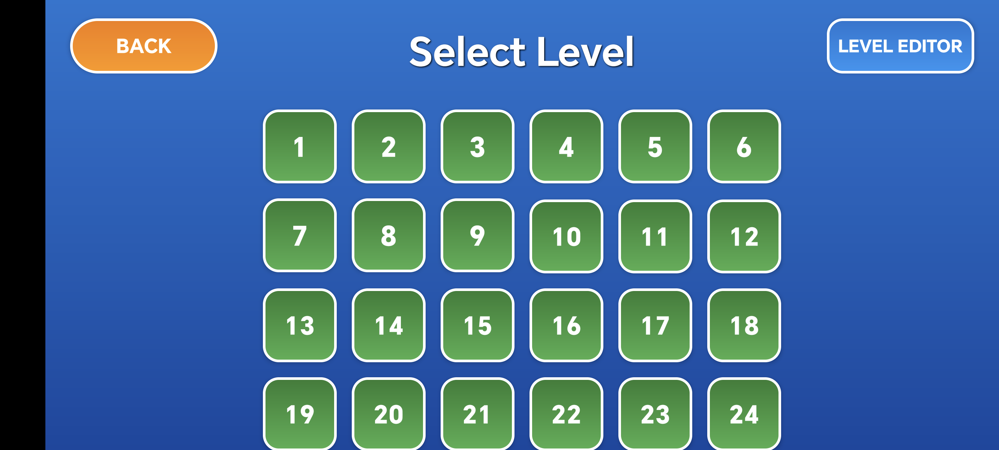
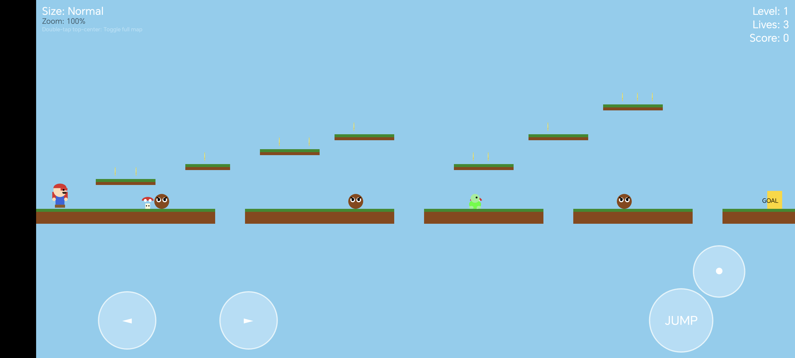
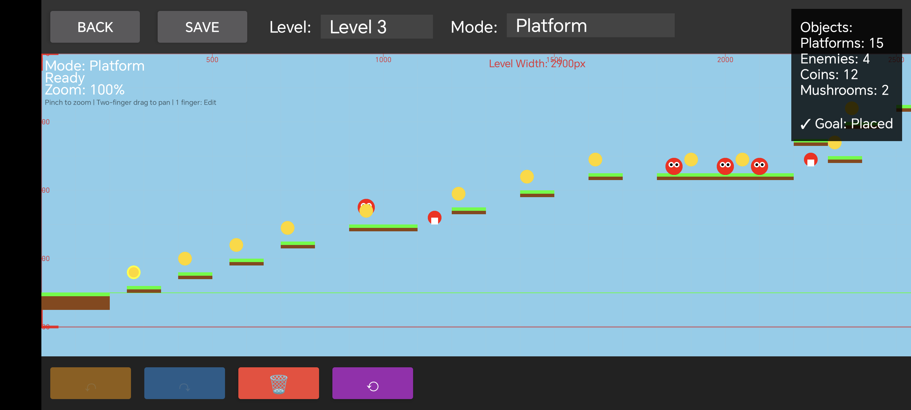

# Test
这是项目测试合集，测试用的项目将会包含在里面，详情请进入不同的项目查看

以下是各个项目的简介

### AIDLTest
用于试验AIDL功能的简单例子

### AudioEdit
音频编辑功能例子，可以对音频进行裁剪，音频拼接插入，音频混合

### Download
下载功能例子，可以同时下载多个文件，并且接收多个文件下载进度的更新

### JavaTest
Java一些知识点的Test例子

### JNITest
JNI使用的一些知识点的例子

### Lottery
幸运转盘实现的例子

### MemoryAnalyzeTest
内存泄漏和内存占用分析测试的例子

### MVVMTest
MVVM模式架构开发的简单例子

### Ripple
实现View视图从矩形变为圆形并缩小的例子，重点在绘制裁剪的实现

### SuperMario (2026.04)
超级玛丽游戏自定义版本。本项目采用AI进行开发，几乎没有手动实现代码，没有使用任何图片，完全使用android原生绘制实现。
对于想开发小游戏，又不想使用游戏引擎的朋友是一个比较好的入门Demo。

- 
- 
- 
- 

特色：
1. 用户可以自定义关卡，通过放置地面，砖块，怪物，金币，蘑菇，目标等道具，来自定义关卡场景。
2. 纯Android原生绘制实现，不依赖任何游戏引擎，对于学习Canvas绘制，动画，触摸事件处理，小游戏实现逻辑非常有帮助。
3. 通过自定义新的怪物，道具，然后进行放置，像搭积木一样，想想是不是很有趣。

页面简介：
- 欢迎页面
- 关卡选择页面，总共30个关卡。前3个关卡已经预定义好了，后面的关卡需要自己编辑实现。
- 游戏页面，点击关卡进入游戏页面。玛丽吃到蘑菇和会变大，抵御一次伤害，再吃到蘑菇后可以发射子弹，可以顶砖块等。
- 关卡编辑页面，目前可以放置地面，砖块，怪物，蘑菇，金币等。支持编辑操作的撤销回退，控件删除，保存，关卡选择预览，画面。

通过本项目，可以学习到：
1. 游戏画面，活动物体包括角色，怪物，金币，蘑菇等，静态物体地面，砖块等是如何实现绘制更新的。
2. 角色的左右移动，跳起，下落，画面跟随镜头移动，踩在地面/砖块上面的实现。
3. 顶了砖块后破碎的动画实现。
4. 碰撞检测和处理，人物和怪物，子弹和怪物，人物和砖块等碰撞的游戏处理。
5. 游戏画面的缩放，平移处理（这点没处理好，会出现平移时缩放抖动问题）
6. 游戏界面关卡数据的加载，关卡编辑页面关卡数据的预览和保存。
7. 关卡编辑页面的道具放置，例如地面，怪物，金币，蘑菇，砖块等道具的放置等。
8. 关卡编辑页面的缩放，平移处理。特别是缩放平移后放置的位置对应处理。

#### 开发有感
完全使用AI开发生成的游戏项目，我通过给AI提需求，一步步让它帮我实现我想要的功能。发现原来仅仅通过Android原生绘制，不需要依赖
任何游戏引擎就可以快速实现一个小游戏，而且功能还是挺丰富的，更有意思的是可以通过自定义关卡，拖拽放置道具就可以实现自己想要的
游戏场景，真的很有意思。让我感觉做一个游戏真的没有想象的那么难，而且还能很快速的实现。